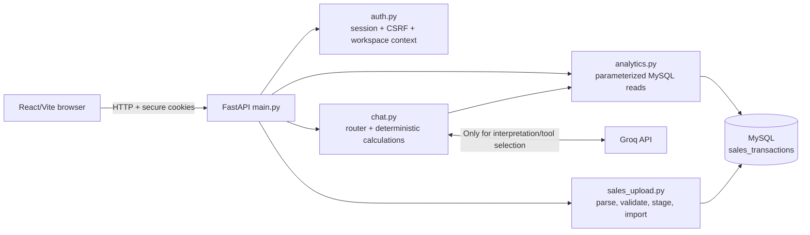
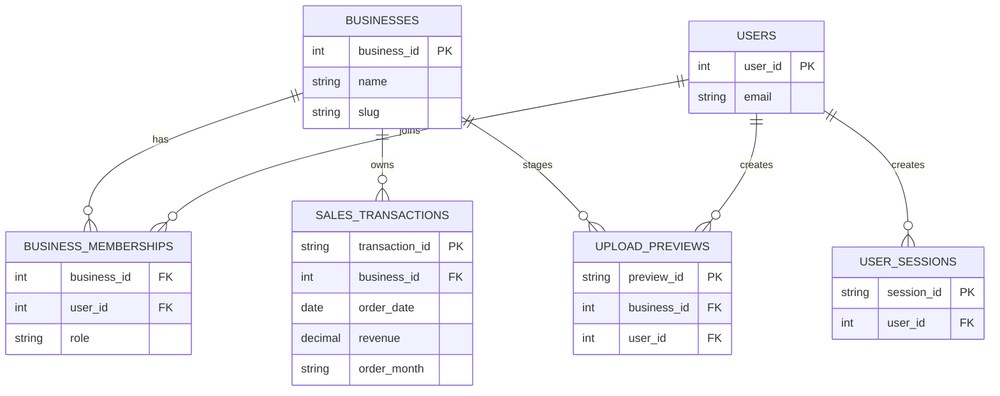

# InsightIQ

InsightIQ is a local business-intelligence application for authenticated
business workspaces. It combines a FastAPI API, MySQL analytics, a React/Vite
dashboard, and a Groq-backed conversational assistant. The backend remains the
source of truth for tenant-scoped sales metrics; the AI interprets verified
results rather than inventing totals or percentages.

> **Status:** Development and demonstration application. Do not use production
> credentials or production data without an appropriate deployment review.

## Contents

1. [Objectives and capabilities](#objectives-and-capabilities)
2. [Technology stack](#technology-stack)
3. [Architecture](#architecture)
4. [Authentication and tenant isolation](#authentication-and-tenant-isolation)
5. [Database design](#database-design)
6. [Sales upload workflow](#sales-upload-workflow)
7. [Analytics dashboard](#analytics-dashboard)
8. [AI assistant and Groq integration](#ai-assistant-and-groq-integration)
9. [Numerical accuracy](#numerical-accuracy)
10. [API reference](#api-reference)
11. [Project structure](#project-structure)
12. [Windows setup and execution](#windows-setup-and-execution)
13. [Testing](#testing)
14. [Demonstration workflow](#demonstration-workflow)
15. [Limitations and future enhancements](#limitations-and-future-enhancements)

## Objectives and capabilities

InsightIQ is designed to:

- show revenue, transaction, quantity, product, region, and monthly analytics;
- keep every analytics query scoped to the authenticated `business_id`;
- accept validated CSV/XLSX sales uploads through a preview-and-confirm flow;
- answer business questions with deterministic backend analytics and clearly
  labelled hypotheses;
- preserve the response structure **Observed Facts**, **Calculated Insights**,
  **Business Hypotheses**, and **Recommendations**.

The application does not calculate profit or margin because cost-of-goods and
operating-cost fields are not available.

## Technology stack

| Layer | Implementation |
|---|---|
| Frontend | React, Vite, `react-markdown`, `remark-gfm` |
| Backend | FastAPI, Uvicorn, Pydantic |
| Database | MySQL with `mysql-connector-python` |
| AI provider | Groq SDK; model defaults to `llama-3.1-8b-instant` |
| Data handling | pandas, NumPy, openpyxl |
| Authentication | Secure cookie sessions, refresh tokens, CSRF protection, Argon2 password hashing |
| Configuration | `python-dotenv` |
| Tests | Python `unittest` with mocked database/provider boundaries |

## Architecture



The browser never supplies the tenant used for authorization. The API derives
the business context from the authenticated session and passes it to analytics,
chat, and upload services.

## Authentication and tenant isolation

`backend/auth.py` provides:

- signup and login with password hashing;
- secure session and refresh-token cookies;
- CSRF bootstrap and validation for state-changing requests;
- authenticated user/business membership lookup;
- logout, refresh, current-user, and available-business endpoints.

Every analytics function requires an `AuthenticatedBusinessContext` and filters
queries with its server-derived `business_id`. Chat tool calls use a
request-scoped context variable, so an LLM tool argument cannot select another
workspace. Upload previews also store and verify the authenticated
`business_id` before confirmation.

## Database design

The existing MySQL deployment contains sales data plus the authentication and
workspace tables managed by the repository's migration materials. This
documentation does not instruct users to alter a database. Apply migrations
only through the project's approved deployment process.

### Sales fact table

`sales_transactions` contains the transaction identifier, order date, product,
category, region, sales channel, quantity, unit price, discount, status,
server-computed revenue, order month, and tenant `business_id`.

Revenue is defined consistently as:

```text
(quantity × unit_price) − discount_amount
```

### Entity relationship diagram



## Sales upload workflow

1. The frontend accepts `.csv` and `.xlsx` files and performs a size pre-check.
2. `POST /sales/upload-preview` reads the file in 64 KiB chunks and rejects
   oversized payloads before parsing.
3. CSV/XLSX content is validated for required columns, dates, positive
   quantities/prices, discounts, completed status, field lengths, row limits,
   and duplicate transaction IDs.
4. Revenue and `order_month` are computed by the backend; client-supplied
   revenue is not trusted.
5. A valid preview is staged in memory with a cryptographically random,
   single-use, 15-minute token bound to the authenticated workspace.
6. `POST /sales/import-confirm` atomically rechecks IDs and inserts the batch.
   Any database error rolls the transaction back.

The current staging store is process-local and therefore intended for local or
single-instance use.

## Analytics dashboard

The React dashboard includes:

- an overview with revenue, transaction, quantity, and average transaction
  value;
- product and regional revenue rankings;
- monthly revenue trend data;
- sales-data management with preview and import confirmation;
- reports/tables with CSV export where exposed by the frontend.

The dashboard calls the authenticated analytics endpoints and refreshes after a
successful import.

## AI assistant and Groq integration

`backend/chat.py` uses a controlled pipeline:

1. classify deterministic intents such as overall summaries, rankings, and
   explicit percentage questions;
2. call approved read-only analytics functions with the authenticated context;
3. calculate derived values in Python;
4. send verified rows, deterministic calculations, and limitations to Groq
   only when language generation is useful;
5. return the grounded answer to the frontend.

The assistant supports the registered analytics functions for overall summary,
product revenue, region revenue, monthly revenue, regional product revenue,
regional product comparison, and regional product performance. The tool loop is
bounded and rejects unapproved arguments.

The final prompt requires the four response sections:

- **Observed Facts** — direct backend values;
- **Calculated Insights** — supplied deterministic calculations;
- **Business Hypotheses** — explicitly uncertain explanations;
- **Recommendations** — evidence-supported actions and limitations.

## Numerical accuracy

Backend analytics is the numerical source of truth.

- INR values are formatted centrally using Indian grouping, for example
  `1479650` becomes `₹14,79,650`.
- Summary, product, regional, and monthly totals are reconciled before being
  presented as verified.
- Product, regional, and monthly revenue shares include explicit numerator,
  denominator, formula, percentage, and status fields.
- Month-over-month changes use
  `((current_revenue - previous_revenue) / previous_revenue) * 100`.
- Zero denominators are marked unavailable rather than divided.
- A comparison involving a partial month is marked
  `unavailable_partial_month`; it is not described as full-month growth or
  decline.
- Minimum and maximum order dates identify incomplete boundary months. For
  example, a latest order date of July 5 means July is incomplete.
- The LLM is instructed not to recalculate or round percentages. It must use
  `verified_percentage_metrics` and state unavailable values explicitly.

The implementation does not modify sales records to correct presentation
errors.

## API reference

The development API runs at `http://127.0.0.1:8000`; FastAPI documentation is
available at `/docs`.

### Authentication

| Method | Path | Purpose |
|---|---|---|
| POST | `/auth/signup` | Create a user/business account |
| POST | `/auth/login` | Start an authenticated session |
| POST | `/auth/refresh` | Refresh session authentication |
| POST | `/auth/csrf` | Bootstrap a CSRF token |
| POST | `/auth/logout` | End the current session |
| GET | `/auth/me` | Return the authenticated user |
| GET | `/auth/businesses` | Return businesses available to the user |

### Analytics and chat

| Method | Path | Purpose |
|---|---|---|
| GET | `/` | Health response |
| GET | `/analytics/summary` | Tenant-scoped summary metrics |
| GET | `/analytics/products` | Tenant-scoped product revenue |
| GET | `/analytics/regions` | Tenant-scoped regional revenue |
| GET | `/analytics/monthly` | Tenant-scoped monthly revenue |
| POST | `/chat` | Grounded conversational analytics |

### Sales management

| Method | Path | Purpose |
|---|---|---|
| POST | `/sales/upload-preview` | Validate and stage CSV/XLSX upload |
| POST | `/sales/import-confirm` | Confirm a valid staged preview |

The chat request accepts `question`, optional `conversation_id`, and optional
validated user/assistant `messages`. Import confirmation accepts a
`preview_id` returned by the preview endpoint. Authentication and CSRF cookies
or headers are required where enforced by the route dependencies.

## Project structure

```text
InsightIQ/
├── .env.example                 # Safe placeholder configuration template
├── .gitignore                   # Excludes .env, .venv, node_modules, backups
├── README.md
├── backend/
│   ├── analytics.py             # Tenant-scoped MySQL analytics
│   ├── auth.py                  # Sessions, CSRF, users, memberships
│   ├── chat.py                  # AI orchestration, tool execution, verified metrics
│   ├── database.py              # MySQL connection factory
│   ├── main.py                  # FastAPI app and API route definitions
│   ├── migration_baseline.py    # Schema verification utilities
│   ├── migrations/              # Database migration materials
│   ├── requirements.txt         # Python dependencies
│   ├── sales_upload.py          # Upload validation and atomic batch import
│   └── test_*.py                # Backend unit & regression tests (208 tests)
└── frontend/
    ├── package.json
    └── src/
        ├── api.js               # Frontend API client and CSRF interceptor
        ├── App.jsx              # Main dashboard view
        ├── AuthProvider.jsx     # React authentication context
        ├── BusinessSelector.jsx # Workspace/tenant switching component
        ├── LoginPage.jsx        # Login interface
        ├── main.jsx             # React entry point
        ├── SalesDataManagement.jsx # Sales upload & preview interface
        ├── SignupPage.jsx       # User registration interface
        └── styles.css           # Styling
```

## Windows setup and execution

Use PowerShell from the repository root. Do not put real credentials in source
control.

```powershell
python -m venv .venv
.\.venv\Scripts\Activate.ps1
pip install -r backend\requirements.txt

cd frontend
npm install
cd ..
```

Create a local `.env` from the safe template and fill values locally:

```powershell
Copy-Item .env.example .env
notepad .env
```

The backend reads variables such as:

```ini
DB_HOST=localhost
DB_PORT=3306
DB_USER=your_mysql_username
DB_PASSWORD=your_mysql_password
DB_NAME=insightiq_dev          # see database initialisation below
GROQ_API_KEY=replace_with_local_secret
AI_MODEL=llama-3.1-8b-instant
AI_TIMEOUT_SECONDS=15
```

### Database initialisation and migration prerequisites

The repository does **not** provide a complete zero-to-one database bootstrap.
The migration files are review-only materials for controlled environments; they
are not a replacement for a verified database backup, a seed-data process, or
an operator-run migration plan. Do not run either migration against an existing
database without a verified backup and schema inspection.

| Phase | File | Purpose and prerequisites |
|---|---|---|
| 1 | `backend/migrations/PHASE1_AUTH_SCHEMA_DRAFT.sql` | Creates authentication, business, session, token, audit, and upload-preview tables. Review the draft and confirm the target database before applying it. It does not create or seed `sales_transactions`, create a legacy workspace, or backfill sales data. |
| 2 | `backend/migrations/PHASE2_SALES_TENANT_MIGRATION.sql` | Adds tenant ownership to an existing legacy sales table. It requires Phase 1's `businesses` table, an existing legacy `sales_transactions` table, exactly the expected legacy baseline data, a populated `pre_migration_sales_inventory` table, and manual verification of every migration gate before proceeding. |

#### Phase 1

Phase 1 is appropriate only after the target database, backup, MySQL version,
and schema have been reviewed. It creates the authentication/workspace schema
but does not provide users, memberships, sales records, or a fresh sample
dataset. The repository has no general-purpose seed script that completes those
steps automatically.

For Windows PowerShell, do not use Unix-style `<` input redirection. Open the
MySQL client interactively and execute the reviewed Phase 1 file using the
client's `source` command, or use an approved database administration tool:

```powershell
mysql -u your_mysql_username -p your_database_name
```

Then, at the `mysql>` prompt, use the path appropriate to your working
directory:

```text
source backend/migrations/PHASE1_AUTH_SCHEMA_DRAFT.sql;
```

Do not treat this as an unattended bootstrap. Review the output and verify the
created tables before continuing.

#### Phase 2

Phase 2 is an advanced, manually gated migration for a legacy database. All of
the following must be true before it is considered runnable:

1. The target contains the existing legacy `sales_transactions` table.
2. The table contains exactly the expected baseline: 50 transactions,
   revenue `1479650.00`, gross sales `1484650.00`, discounts `5000.00`,
   quantity `652`, transaction IDs `TXN0001` through `TXN1002` as bounded by
   the migration checks, earliest order date `2026-01-03`, and latest order
   date `2026-07-05`.
3. Phase 1 has been reviewed and applied so `businesses(business_id)` exists.
4. `pre_migration_sales_inventory` has been populated with exactly the
   expected 50-row legacy inventory and its aggregate values match the
   mandatory inventory gate.
5. A verified backup and schema inspection have been completed.
6. The operator runs the Phase 2 sections manually and stops at every
   instruction requiring a `PASS`, empty result, or other gate confirmation.

The repository does include the Phase 2 migration and scratch-test materials,
but it does not provide a missing seed file or an automated command that
creates the required legacy baseline and inventory table. Obtain the baseline
from an approved, verified legacy export or backup, and prepare
`pre_migration_sales_inventory` only through a separately reviewed scratch
rehearsal and data-validation process. Do not guess, recreate, or silently
substitute baseline rows.

Phase 2 must not be piped as one batch because its SQL explicitly requires
manual stops before backfill and final DDL. Start an interactive client:

```powershell
mysql -u your_mysql_username -p your_legacy_database
```

Do **not** use `source` for the complete Phase 2 file, because it contains
explicit manual stop points and final DDL that must not run automatically.
Instead, use an approved SQL administration tool or an interactive client to
copy and execute each reviewed section manually, pausing after every gate.
Never proceed after a baseline, inventory, business identity, post-backfill,
row-preservation, or aggregate gate reports a mismatch.

The migration files do not contain a complete fresh-database procedure:
Phase 2 cannot run without the legacy table and verified baseline inventory,
and no repository seed script supplies those prerequisites. For a new
developer environment, obtain an approved database snapshot/export or prepare
the required data through the project's reviewed data-management process before
attempting these migrations. If that prerequisite data is unavailable, the
application cannot be bootstrapped from this repository alone.

After a separately approved migration has completed, set `DB_NAME` to the
verified target database in `.env`, start the backend, and use the authenticated
Sales Data upload workflow for additional records. Do not change `.env` or
apply migrations simply to make an existing database fit the application.

Start the services in separate PowerShell windows:

```powershell
# Backend, from repository root
.\.venv\Scripts\Activate.ps1
Set-Location backend
..\.venv\Scripts\python.exe -m uvicorn main:app --reload
```

```powershell
# Frontend, from repository root
Set-Location frontend
npm run dev
```

The Vite development server normally runs at `http://localhost:5173`.

## Testing

The backend tests use `unittest`; database and provider calls are mocked for
regression coverage. Run the focused numerical suite:

```powershell
Set-Location backend
..\.venv\Scripts\python.exe -m unittest test_numerical_accuracy -v
```

Run the backend regression suite while excluding the scratch provider test:

```powershell
..\.venv\Scripts\python.exe -m unittest `
  test_auth test_auth_routes `
  test_sales_upload test_sales_upload_tenant `
  test_analytics test_analytics_tenant `
  test_chat_routes test_migration_baseline `
  test_numerical_accuracy -q
```

The verification run for this implementation completed with **208 passing
tests and 0 failures** (56 numerical-accuracy tests plus the full backend
regression selection). `scratch_gemini_test.py` is intentionally excluded.
The frontend was not changed for this work; its production build can be
checked with:

```powershell
Set-Location frontend
npm run build
```

## Demonstration workflow

1. Start MySQL and the backend with local environment values.
2. Start the Vite frontend.
3. Sign up or log in, then obtain the CSRF token when prompted by the client.
4. Select an authenticated business workspace.
5. Open the dashboard and review summary, product, region, and monthly values.
6. Open the assistant and ask for an overall summary or a revenue ranking.
7. Ask a percentage question and verify that the answer uses backend-labelled
   values rather than a newly calculated value.
8. Upload a CSV/XLSX file, inspect rejected rows in the preview, and confirm
   only after validation succeeds.
9. Refresh the dashboard and verify the imported workspace-scoped analytics.
10. For a dataset ending on July 5, inspect the response limitation before
    interpreting July against a complete month.

## Limitations and future enhancements

### Current limitations

- Preview staging is process-local and is not suitable for multiple backend
  workers without a shared store.
- Automated database tests use mocks rather than a dedicated integration
  database.
- Groq availability, rate limits, and network latency can affect generated
  explanations.
- Revenue data cannot establish profit, margin, retention, causality, or
  marketing ROI.
- Boundary-date logic identifies partial first/last months but cannot detect
  missing transactions inside an otherwise complete calendar month.
- The frontend has no separate production deployment configuration in this
  repository.

### Future enhancements

- Move preview staging to a shared, expiring store for multi-process deployment.
- Add isolated MySQL integration tests and CI environment checks.
- Add explicit date-range and category analytics.
- Add cost and margin data only when reliable source fields are available.
- Add frontend unit and end-to-end tests.
- Add observability and deployment configuration for production operation.

No credentials, tokens, database records, schemas, or `.env` files are included
in this documentation.
