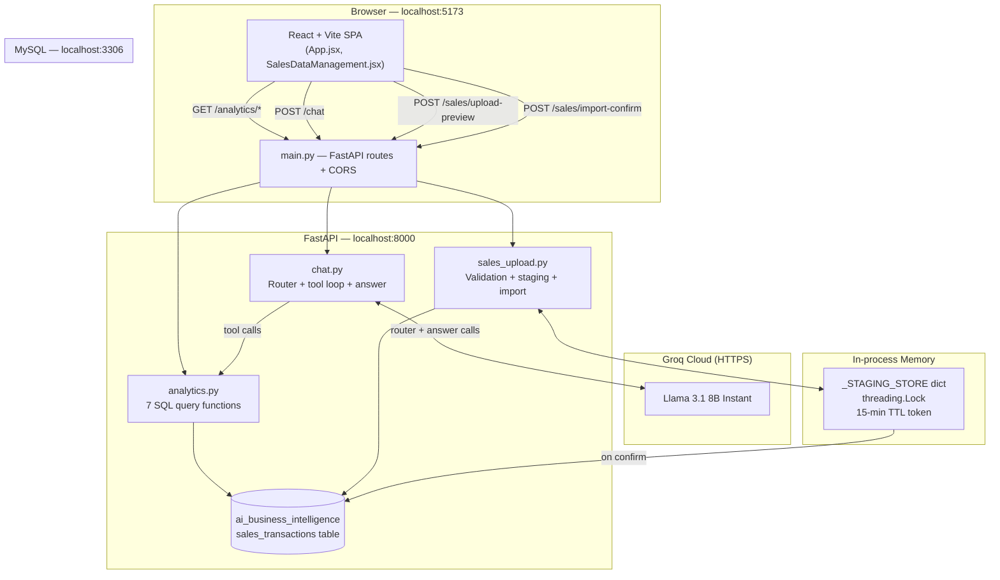

# InsightIQ
### Your Business. Your Data. Your Intelligence.

A local AI-powered business intelligence application combining a **FastAPI backend**, **MySQL database**, **Groq-hosted LLM**, and a **React + Vite frontend** to deliver conversational analytics, visual dashboards, and CSV/XLSX data ingestion for sales data.

> **Status:** Development / demonstration tool. Not production-ready. Designed for single-instance, local use.

---

## Table of Contents

1. [Project Overview](#1-project-overview)
2. [Key Features](#2-key-features)
3. [Technology Stack](#3-technology-stack)
4. [System Architecture](#4-system-architecture)
5. [Application Workflow](#5-application-workflow)
6. [Database Schema](#6-database-schema)
7. [Data Preprocessing and Validation Rules](#7-data-preprocessing-and-validation-rules)
8. [AI Assistant Architecture](#8-ai-assistant-architecture)
9. [API Endpoints](#9-api-endpoints)
10. [CSV/XLSX Upload Workflow](#10-csvxlsx-upload-workflow)
11. [Project Folder Structure](#11-project-folder-structure)
12. [Prerequisites](#12-prerequisites)
13. [Installation (Windows)](#13-installation-windows)
14. [Environment Variable Setup](#14-environment-variable-setup)
15. [Starting the Application](#15-starting-the-application)
16. [Running Backend Tests](#16-running-backend-tests)
17. [Test Results](#17-test-results)
18. [Dataset Description](#18-dataset-description)
19. [Current Limitations and Future Enhancements](#19-current-limitations-and-future-enhancements)

---

## 1. Project Overview

Many small and medium businesses collect sales data but lack the capability to derive reliable, real-time insights from it. InsightIQ addresses this by providing:

- A **conversational AI assistant** that answers natural-language business questions using live database data — never invented values.
- A **visual analytics dashboard** with KPI cards, product revenue rankings, regional breakdowns, and monthly trends.
- A **structured data upload pipeline** that validates, previews, and safely imports new CSV or Excel sales records into MySQL.
- A **reports page** with CSV export of tabular data for offline analysis.

The project emphasises **data integrity**: revenue is always computed server-side from `(quantity × unit_price) − discount_amount`; profitability claims are explicitly blocked because cost data is unavailable; every AI response is grounded exclusively in data returned by read-only analytics functions.

---

## 2. Key Features

### AI Assistant
- Conversational natural-language interface for sales analytics.
- Powered by **Groq** (Llama 3.1 8B Instant) with a structured two-pass reasoning pipeline: router → tool calls → grounded answer.
- Seven registered analytics tools backed by live MySQL queries.
- **Deterministic fast-path**: five common question patterns (overall summary, top product, top region, regional channel comparison, regional comparison) are answered directly from database data with **zero LLM calls**, eliminating latency and API cost.
- Strict grounding rules: no profitability claims, no margin calculations, no invented metrics.
- Conversation history support (up to 10 messages, 20,000 characters total).
- Groq rate-limit detection with structured HTTP 429 responses including retry-after seconds.

### Analytics Dashboard
- **Overview tab**: total revenue, total transactions, total quantity, average revenue per transaction; top product and top region leaderboards.
- **Analytics tab**: product revenue rankings, region revenue breakdown, monthly revenue trend.
- **Reports tab**: full transaction table with per-section CSV download (products, regions, monthly).

### Sales Data Management (CSV / XLSX Upload)
- Drag-and-drop or file-picker upload of `.csv` and `.xlsx` files.
- Client-side 10 MB pre-check before upload.
- Server-side **streaming chunk read** (64 KB chunks) that aborts with HTTP 413 before the full payload is buffered.
- XLSX ZIP inspection (entry count, uncompressed size, expansion ratio) before parsing.
- Maximum 5,000 data rows per upload.
- Per-row validation with specific rejection messages.
- Preview staging with a 15-minute, single-use, cryptographically secure token.
- Atomic MySQL batch insert with rollback on any failure.
- In-file and database duplicate transaction ID detection (TOCTOU-safe).
- Dashboard automatic refresh after a successful import.

### Data Integrity
- Revenue always computed server-side; client-supplied revenue fields in uploads are ignored.
- Text field length limits enforced per field; oversized values are rejected, never silently truncated.
- Only `Completed` status transactions are accepted for import.

---

## 3. Technology Stack

| Layer | Technology | Notes |
|---|---|---|
| **Frontend** | React 18.3.1 | |
| **Frontend build** | Vite 6.0.7 | |
| **Markdown rendering** | react-markdown 10.1.0 + remark-gfm 4.0.1 | Chat responses |
| **Backend** | FastAPI | ASGI web framework |
| **ASGI server** | Uvicorn | Dev mode with `--reload` |
| **AI provider** | Groq — Llama 3.1 8B Instant | Via `groq` Python SDK |
| **Database** | MySQL 8.x | Local server |
| **DB driver** | mysql-connector-python | |
| **Data processing** | pandas, numpy | |
| **Excel parsing** | openpyxl | |
| **Multipart upload** | python-multipart | |
| **Config** | python-dotenv | Reads `.env` from project root |
| **Python runtime** | 3.13 (tested) | 3.11+ required |
| **Node.js** | 18+ | For npm / Vite |

---

## 4. System Architecture



---

## 5. Application Workflow

### Analytics query flow

```
User types question in browser
        │
        ▼
POST /chat  →  chat.py: answer_question()
        │
        ├─ Deterministic fast-path check
        │    5 known intents matched by keyword pattern:
        │    overall summary · top product · top region ·
        │    regional channel comparison · regional comparison
        │    → returns answer from live DB data, zero Groq calls
        │
        └─ Groq router call (non-deterministic questions)
                │  system prompt + question + conversation history
                │  conservative tool subset selected automatically
                ▼
           Groq selects analytics tools to call
                │
                ▼
           Tool execution loop (up to 4 rounds)
                │  analytics.py → MySQL parameterised queries → results
                ▼
           Groq final-answer call
                │  strict grounding prompt + all tool results
                ▼
           JSON response → ReactMarkdown → chat panel
              { answer, business_data, timings_ms }
```

### Data upload flow

```
User selects / drops CSV or XLSX file
        │
        ├─ Client checks: extension, file.size ≤ 10 MB
        │
        ▼
POST /sales/upload-preview
        │  64 KB streaming chunks — abort at 10 MB → HTTP 413
        │
        ▼
sales_upload.parse_and_validate_file()
        ├─ XLSX: magic bytes + ZIP inspection
        │    (entries ≤ 1,024 · uncompressed ≤ 50 MB · ratio ≤ 100:1)
        ├─ Row count ≤ 5,000
        ├─ Header normalisation + missing column detection
        ├─ Per-row validation loop:
        │    • Missing required fields
        │    • Text field length limits
        │    • Date format (YYYY-MM-DD or DD-MM-YYYY)
        │    • Quantity: positive integer
        │    • Unit price: > 0
        │    • Discount: ≥ 0 and ≤ gross amount
        │    • Status = "Completed" only
        │    • In-file duplicate transaction ID
        │    • Database duplicate transaction ID (batched SELECT)
        ├─ Revenue recalculated server-side for valid rows
        └─ Valid rows staged in memory under secrets.token_urlsafe(32)
        │
        ▼
Preview response to browser
   { preview_id, summary, valid_records_preview, rejected_records }
        │
User reviews counts and rejection reasons
        │
        ▼  user clicks "Confirm & import"
POST /sales/import-confirm  { "preview_id": "..." }
        │
        ├─ Token popped atomically (single-use enforced)
        ├─ Expiry re-checked
        ├─ Duplicate IDs re-queried in DB (TOCTOU protection)
        ├─ executemany() batch INSERT in single MySQL transaction
        └─ commit() on success  /  rollback() on any exception
        │
        ▼
Dashboard analytics auto-refreshed in browser
```

### Initial dataset seeding

```
preprocessing.ipynb
   → backend/data/cleaned_sales.csv  (48 rows)
   → backend/data/rejected_sales.csv (3 rows)
            │
            ▼
    python backend/insert_data.py
            │
            ▼
    MySQL: ai_business_intelligence.sales_transactions
```

---

## 6. Database Schema

**Database:** `ai_business_intelligence`
**Table:** `sales_transactions`

| Column | Actual Type | Notes |
|---|---|---|
| `transaction_id` | `VARCHAR(20)` | Primary key; unique per transaction |
| `order_date` | `DATE` | Transaction date |
| `product` | `VARCHAR(100)` | Product name |
| `category` | `VARCHAR(100)` | E.g. Accessories, Furniture, Electronics |
| `region` | `VARCHAR(50)` | North, South, East, West |
| `sales_channel` | `VARCHAR(30)` | Retail or Online |
| `quantity` | `INT` | Units sold; positive integer |
| `unit_price` | `DECIMAL(10,2)` | Price per unit before discount |
| `discount_amount` | `DECIMAL(10,2)` | Absolute discount; ≥ 0 |
| `status` | `VARCHAR(30)` | Only `Completed` records are stored |
| `revenue` | `DECIMAL(12,2)` | `(quantity × unit_price) − discount_amount` |
| `order_month` | `VARCHAR(7)` | Derived as `YYYY-MM`; used for monthly aggregation |

> **Revenue integrity:** `revenue` is always computed server-side. Client-supplied values in uploaded files are ignored and recalculated.

---

## 7. Data Preprocessing and Validation Rules

The original `backend/data/sales.csv` was cleaned in `backend/preprocessing.ipynb`. The same rules are enforced during every CSV/XLSX upload.

### Rejection criteria

| Rule | Detail |
|---|---|
| Missing required field | Any of the 10 required columns is null or empty |
| Invalid date | Not parseable as `YYYY-MM-DD` or `DD-MM-YYYY` |
| Non-positive quantity | Quantity ≤ 0 or not an integer |
| Non-positive unit price | Unit price ≤ 0 |
| Negative discount | Discount < 0 |
| Excessive discount | Discount > quantity × unit price |
| Non-completed status | Status is not `Completed` (e.g. Returned, Cancelled) |
| In-file duplicate ID | Transaction ID appears more than once in the file |
| Database collision | Transaction ID already exists in MySQL |
| Text field too long | Exceeds the per-field character limit (see table below) |

### Text field length limits (enforced during upload)

| Field | Maximum length |
|---|---|
| `transaction_id` | 20 characters |
| `product` | 100 characters |
| `category` | 100 characters |
| `region` | 50 characters |
| `sales_channel` | 30 characters |
| `status` | 30 characters |

Oversized values are **rejected with a row-specific message** — never silently truncated.

### Original dataset preprocessing outcome

From the 51-row raw `sales.csv`:

| Outcome | Count | Reason |
|---|---|---|
| Valid records loaded into MySQL | 48 | Passed all rules |
| `TXN0033` rejected | 1 | Status = Returned |
| `TXN0034` rejected | 1 | Quantity = 0 |
| `TXN0051` rejected | 1 | Missing Unit_price |

---

## 8. AI Assistant Architecture

### Two-pass pipeline

```
Question
  │
  ├─ 1. Deterministic fast-path (no LLM call)
  │       Five intent patterns matched by keyword regex.
  │       Answer built directly from live DB query results.
  │
  └─ 2. Groq router call
           → tool selection (up to 4 tool-call rounds)
           → tool execution against MySQL
           → Groq final-answer call with strict grounding prompt
```

### Groq integration details

| Setting | Value / Default |
|---|---|
| Model | `AI_MODEL` env var; default `llama-3.1-8b-instant` |
| Request timeout | `AI_TIMEOUT_SECONDS` env var; default 15 s |
| Max retries | 0 (immediate failure on error) |
| Max tool rounds | 4 per request |
| Conversation history | ≤ 10 messages · ≤ 4,000 chars each · ≤ 20,000 chars total |

### Three system prompts

| Prompt | Role |
|---|---|
| `ROUTER_SYSTEM_PROMPT` | Selects analytics tools; treats prior assistant messages as untrusted context |
| `GENERAL_SYSTEM_PROMPT` | Used for conversational turns that need no tool (greetings, concept questions, out-of-scope) |
| `ANSWER_SYSTEM_PROMPT` | Requires the model to use only returned DB data; enforces calculation transparency, output structure, and terminology rules |

### Enforced grounding rules (in `ANSWER_SYSTEM_PROMPT`)

- No profitability or margin claims — cost data is unavailable.
- No causal interpretations from revenue rankings alone.
- `revenue ÷ quantity` is reported only as average revenue-per-unit, never as margin.
- Pair-share percentages do not imply basket co-purchase.
- Promotional recommendations are framed as measurable experiments, not guaranteed outcomes.
- Indian digit grouping enforced: `₹1,89,000` not `₹189,000`.
- Answers structured as: **Observed Facts → Calculated Insights → Business Hypotheses → Recommendations**.

### Seven registered analytics tools

| Tool | Description | Parameters |
|---|---|---|
| `get_sales_summary` | Overall transaction count, total quantity, total revenue, average revenue | None |
| `get_product_revenue` | Revenue per product, sorted descending | None |
| `get_region_revenue` | Revenue per region, sorted descending | None |
| `get_monthly_revenue` | Revenue per month, sorted chronologically | None |
| `get_product_revenue_by_region` | Product revenue, quantity, and transaction count for one region | `region` (string) |
| `compare_products_by_region` | Compare selected products, or all products, within one region | `region` (string), `products` (string array, optional) |
| `get_region_product_performance` | Region name and its products ordered by revenue | `region` (string) |

---

## 9. API Endpoints

All endpoints are served by FastAPI on `http://127.0.0.1:8000`.
Interactive docs available at `http://127.0.0.1:8000/docs`.

| Method | Path | Purpose |
|---|---|---|
| `GET` | `/` | Health check |
| `GET` | `/analytics/summary` | Overall KPIs: transactions, quantity, revenue, average |
| `GET` | `/analytics/products` | Product revenue ranked descending |
| `GET` | `/analytics/regions` | Region revenue ranked descending |
| `GET` | `/analytics/monthly` | Monthly revenue sorted chronologically |
| `POST` | `/chat` | Conversational AI query (JSON body) |
| `POST` | `/sales/upload-preview` | Upload CSV/XLSX for validation and preview (multipart/form-data, field: `file`) |
| `POST` | `/sales/import-confirm` | Atomically import a valid staged preview (JSON body) |

### `/chat` — request body

```json
{
  "question": "Which product generates the highest revenue?",
  "conversation_id": "optional-uuid-string",
  "messages": [
    { "role": "user",      "content": "..." },
    { "role": "assistant", "content": "..." }
  ]
}
```

### `/sales/import-confirm` — request body

```json
{ "preview_id": "token-returned-by-upload-preview" }
```

### CORS configuration

| Setting | Value |
|---|---|
| Allowed origins | `http://localhost:5173`, `http://127.0.0.1:5173` |
| Allowed methods | `GET`, `POST`, `OPTIONS` |
| Allowed headers | `Content-Type`, `Accept`, `Authorization` |
| Credentials | Disabled |

---

## 10. CSV/XLSX Upload Workflow

### Supported formats

| Format | Extension | Encoding |
|---|---|---|
| CSV | `.csv` | UTF-8 (with or without BOM) or Latin-1 |
| Excel | `.xlsx` | Open XML only — `.xls` and `.xlsm` not supported |

### Required columns (case-insensitive, order-independent)

```
Transaction_Id   Order_date   Product   Category   Region
Sales_channel    Quantity     Unit_price Discount_amount   Status
```

> `Revenue` and `Order_Month` columns, if present, are **ignored** — both are computed server-side.

### Security gates applied before parsing

| Gate | Limit | Applies to |
|---|---|---|
| File extension check | `.csv` or `.xlsx` only | Both |
| Streaming size abort | 10 MB | Both |
| Magic byte check | Must start with `PK\x03\x04` | XLSX only |
| ZIP entry count | ≤ 1,024 entries | XLSX only |
| ZIP uncompressed size | ≤ 50 MB total | XLSX only |
| ZIP expansion ratio | ≤ 100:1 | XLSX only |
| Row count cap | ≤ 5,000 data rows | Both |

### Preview token security properties

| Property | Implementation |
|---|---|
| Entropy | `secrets.token_urlsafe(32)` — 256-bit |
| Single-use | `dict.pop()` under `threading.Lock` — atomic removal before any DB work |
| Time-limited | 15-minute TTL (`expires_at` checked at confirm time) |
| Thread-safe | All reads/writes guarded by `threading.Lock` |

> **Preview staging uses in-process memory.** This is appropriate for the current single-instance local deployment. A multi-process or horizontally scaled deployment would require an external store such as Redis.

### Import confirmation safety sequence

1. Token popped atomically (prevents double-confirmation).
2. Expiry re-checked after pop.
3. All candidate transaction IDs re-queried in the database inside the open transaction (TOCTOU protection).
4. `cursor.executemany()` batch INSERT within a single MySQL transaction (`autocommit = False`).
5. `connection.commit()` on success; `connection.rollback()` on any exception — zero partial imports.

> **Automated test note:** All import-confirmation tests in `test_sales_upload.py` use mocked database connections. No records are inserted into the live database during testing.

---

## 11. Project Folder Structure

```
rsg_research_private_Ltd_project/
├── .env                          ← Real credentials (never commit)
├── .env.example                  ← Safe template (safe to commit)
├── .gitignore
├── .venv/                        ← Python virtual environment
│
├── backend/
│   ├── analytics.py              ← 7 SQL analytics functions
│   ├── chat.py                   ← AI assistant: router, tool loop, answer pipeline
│   ├── database.py               ← MySQL connection factory
│   ├── insert_data.py            ← One-time dataset seeding script
│   ├── main.py                   ← FastAPI app, CORS middleware, all route handlers
│   ├── preprocessing.ipynb       ← Jupyter notebook: data cleaning and validation
│   ├── requirements.txt          ← Python dependencies
│   ├── sales_upload.py           ← Upload parsing, ZIP inspection, validation, staging, import
│   ├── test_analytics.py         ← 57 analytics and AI pipeline tests
│   ├── test_sales_upload.py      ← 33 upload validation and security hardening tests
│   ├── test_gemini.py            ← Gemini integration test (requires separate API key)
│   └── data/
│       ├── sales.csv             ← Original raw dataset (51 rows)
│       ├── cleaned_sales.csv     ← Valid records after preprocessing (48 rows)
│       └── rejected_sales.csv    ← Records rejected during preprocessing (3 rows)
│
└── frontend/
    ├── index.html
    ├── package.json
    └── src/
        ├── App.jsx               ← Navigation, dashboard tabs, chat panel, reports
        ├── SalesDataManagement.jsx ← Upload page: dropzone, preview tables, confirm modal
        ├── api.js                ← fetch() wrappers and API helper functions
        ├── main.jsx              ← React entry point
        └── styles.css            ← All styles (dark theme, glassmorphism, responsive)
```

---

## 12. Prerequisites

| Requirement | Minimum version | Where to get it |
|---|---|---|
| Python | 3.11 | [python.org/downloads](https://www.python.org/downloads/) |
| Node.js + npm | 18 | [nodejs.org](https://nodejs.org/) |
| MySQL | 8.x | [dev.mysql.com](https://dev.mysql.com/downloads/mysql/) |
| Groq API key | — | Free tier at [console.groq.com](https://console.groq.com) |

---

## 13. Installation (Windows)

### Step 1 — Obtain the project files

```powershell
# Using git:
git clone <repository-url>
cd <project-folder>
```

### Step 2 — Create and activate the Python virtual environment

```powershell
# From the project root:
python -m venv .venv
.\.venv\Scripts\Activate.ps1
```

### Step 3 — Install Python dependencies

```powershell
pip install -r backend\requirements.txt
```

### Step 4 — Install frontend dependencies

```powershell
cd frontend
npm install
cd ..
```

### Step 5 — Create the MySQL database and table

Connect to your MySQL server and execute:

```sql
CREATE DATABASE ai_business_intelligence
  CHARACTER SET utf8mb4
  COLLATE utf8mb4_unicode_ci;

USE ai_business_intelligence;

CREATE TABLE sales_transactions (
    transaction_id   VARCHAR(20)    NOT NULL,
    order_date       DATE           NOT NULL,
    product          VARCHAR(100)   NOT NULL,
    category         VARCHAR(100)   NOT NULL,
    region           VARCHAR(50)    NOT NULL,
    sales_channel    VARCHAR(30)    NOT NULL,
    quantity         INT            NOT NULL,
    unit_price       DECIMAL(10,2)  NOT NULL,
    discount_amount  DECIMAL(10,2)  NOT NULL,
    status           VARCHAR(30)    NOT NULL,
    revenue          DECIMAL(12,2)  NOT NULL,
    order_month      VARCHAR(7)     NOT NULL,
    PRIMARY KEY (transaction_id)
) ENGINE=InnoDB DEFAULT CHARSET=utf8mb4 COLLATE=utf8mb4_0900_ai_ci;
```

### Step 6 — Configure environment variables

```powershell
copy .env.example .env
notepad .env        # fill in your MySQL credentials and Groq API key
```

See [Section 14](#14-environment-variable-setup) for all variables.

### Step 7 — Seed the database with the sample dataset

```powershell
# From the project root with .venv active:
cd backend
python insert_data.py
```

Expected output: `Records inserted: 48`

---

## 14. Environment Variable Setup

Copy `.env.example` to `.env` in the **project root** and set:

```ini
# MySQL connection
DB_HOST=localhost
DB_PORT=3306
DB_USER=your_mysql_username
DB_PASSWORD=your_mysql_password
DB_NAME=ai_business_intelligence

# Groq AI — MANDATORY. The backend will not start without this key.
# chat.py raises RuntimeError at import time if GROQ_API_KEY is missing.
# Obtain a free key at https://console.groq.com
GROQ_API_KEY=your_groq_api_key_here

# Optional — defaults shown if omitted
AI_MODEL=llama-3.1-8b-instant
AI_TIMEOUT_SECONDS=15
```

> The `.env` file is read from the project root by both `database.py` and `chat.py` using `python-dotenv`. **Never commit the real `.env` file to version control.**
> `GROQ_API_KEY` is checked at module import: if it is absent or empty, `chat.py` raises a `RuntimeError` and the backend process exits immediately.

---

## 15. Starting the Application

Open **two separate terminal windows**, both with `.venv` active.

### Terminal 1 — Backend

```powershell
# From the project root:
.\.venv\Scripts\Activate.ps1
cd backend
..\.venv\Scripts\python.exe -m uvicorn main:app --reload
```

- API available at: `http://127.0.0.1:8000`
- Interactive API docs: `http://127.0.0.1:8000/docs`

### Terminal 2 — Frontend

```powershell
# From the project root:
cd frontend
npm run dev
```

- Application available at: `http://localhost:5173`

---

## 16. Running Backend Tests

Run from the `backend/` directory with `.venv` active:

```powershell
# From the project root:
.\.venv\Scripts\Activate.ps1
cd backend
```

### Upload tests only (41 tests)

```powershell
..\.venv\Scripts\python.exe -m unittest test_sales_upload -v
```

### Analytics tests only (57 tests)

```powershell
..\.venv\Scripts\python.exe -m unittest test_analytics -v
```

### Both suites together (98 tests)

```powershell
..\.venv\Scripts\python.exe -m unittest test_sales_upload test_analytics -v
```

> **Database safety:** All test database interactions are mocked using `unittest.mock.MagicMock`. The test suite does not connect to or modify the live MySQL database.

> Note: `scratch_gemini_test.py` is an obsolete prototype script that requires `GEMINI_API_KEY` and is excluded from test discovery.

---

## 17. Test Results

Verified by running both test files against the current source code.

### `test_sales_upload.py` — 41 tests

| Class | Tests | Areas covered |
|---|---|---|
| `TestSalesUploadValidation` | 11 | Valid CSV/XLSX preview, missing columns, invalid dates, bad quantities/prices, invalid discounts, non-completed status, in-file duplicates, DB collision, wrong extension, oversized file, server-side revenue recalculation |
| `TestSalesImportConfirmation` | 5 | Unknown token, preview expiry, successful batch insert (mocked DB), rollback on DB error, TOCTOU re-check at confirm |
| `TestSecurityHardening` | 25 | Streaming 10 MB abort, file at exact limit, XLSX excessive expansion ratio, XLSX too many ZIP entries, XLSX excessive uncompressed size, valid XLSX passes inspection, CSV/XLSX max rows rejected, file at row limit accepted, oversized transaction ID, oversized product name, oversized region, text at max length accepted, no silent truncation, product name starting with `-` preserved, product name starting with `+` preserved, transaction ID max length boundaries (20 accepted, 21 rejected), region max length boundaries (50 accepted, 51 rejected), sales channel max length boundaries (30 accepted, 31 rejected), status max length boundaries (30 accepted, 31 rejected) |

```
Ran 41 tests in ~3.9s
OK  (0 failures, 0 errors, 0 skipped)
```

### `test_analytics.py` — 57 tests

| Class | Tests | Areas covered |
|---|---|---|
| `TestGetSalesSummary` | 2 | Return types, connection lifecycle |
| `TestGetProductRevenue` | 2 | Row count, revenue float type |
| `TestGetRegionRevenue` | 2 | Region presence, revenue type |
| `TestGetMonthlyRevenue` | 2 | Month count, revenue type |
| `TestGetProductRevenueByRegion` | 3 | South product count, type conversion, unknown region error |
| `TestGetChannelRevenueByRegion` | 4 | Channel names, revenue values, structure, types |
| `TestGetRegionalChannelSummary` | 5 | Both regions returned, channel count, South Retail revenue, value types, empty list error |
| `TestGetRegionProductPerformance` | 2 | Keys present, products is list |
| `TestZeroGroqDeterministicResponses` | 4 | Five questions use zero Groq calls, overall summary intent, regional comparison intent, complex question still calls Groq |
| `TestDeterministicRecommendationEvidence` | 31 | Grounding rules, terminology restrictions, channel breakdown, regional comparison data, basket analysis limits, cost data availability, recommendation framing |

```
Ran 57 tests in ~1.6s
OK  (0 failures, 0 errors, 0 skipped)
```

### Combined result

```
Ran 98 tests in ~4.8s
OK  (0 failures, 0 errors, 0 skipped)
```

---

## 18. Dataset Description

> The data currently in MySQL is a **sample demonstration dataset**. It does not represent real business data.

### Source files

| File | Rows | Description |
|---|---|---|
| `backend/data/sales.csv` | 51 | Original raw dataset |
| `backend/data/cleaned_sales.csv` | 48 | Post-validation records loaded into MySQL |
| `backend/data/rejected_sales.csv` | 3 | Records excluded by preprocessing |

### Dataset characteristics

| Dimension | Values present |
|---|---|
| Date range | January 2026 – June 2026 (6 months) |
| Products | Laptop Stand, Wireless Mouse, Office Chair, Monitor, Keyboard, Desk, USB-C Hub |
| Categories | Accessories, Furniture, Electronics |
| Regions | North, South, East, West |
| Sales channels | Retail, Online |
| Statuses | Completed only (after preprocessing) |

### Baseline metrics (48-row sample dataset)

| Metric | Value |
|---|---|
| Total transactions | 48 |
| Total quantity sold | 633 units |
| Total revenue | ₹14,39,200 |
| Average revenue per transaction | ≈ ₹29,983 |
| Highest-revenue product | Monitor — ₹4,73,000 |
| Highest-revenue region | South — ₹4,11,200 |
| North revenue | ₹3,84,450 |
| South Retail revenue | ₹2,12,150 |

> **Profitability note:** Cost of goods sold (COGS) and operational costs are **not available** in this dataset. Profitability, gross margin, and net margin cannot be calculated or claimed from the available data. The AI assistant explicitly refuses such claims.

---

## 19. Current Limitations and Future Enhancements

### Current limitations

| Area | Detail |
|---|---|
| **Import testing** | All `import-confirm` tests mock the database connection. No automated end-to-end test inserts into a real test database. |
| **Preview staging** | Uses an in-process Python dict with `threading.Lock`. Not suitable for multi-process or horizontally scaled deployments. |
| **Upload buffering** | Streaming read aborts at 10 MB, but accepted chunks are joined into a single `bytes` object in memory before parsing. High concurrency could cause memory pressure. |
| **XLSX decompression** | Only aggregate ZIP metadata (total uncompressed size, ratio) is checked. A single very large XML member within the budget could still cause a large allocation. |
| **Authentication** | No user authentication or authorisation. Intended for single-user local use only. |
| **Multi-tenancy** | All data is in a single table with no tenant isolation. |
| **Cost / profitability** | COGS and margin data are unavailable; profitability analytics cannot be implemented without additional data. |
| **Git repository** | The project is not currently initialised as a git repository. |
| **Groq rate limits** | The free Groq tier has token-per-minute and token-per-day limits. Heavy use may trigger HTTP 429 responses. |
| **Date formats** | Only `YYYY-MM-DD` and `DD-MM-YYYY` are formally validated. Other formats may parse via a pandas fallback but are not guaranteed. |

### Future enhancements

- **Automated end-to-end import test** against an isolated test database (not mocked).
- **Redis-based preview staging** for multi-instance or multi-process deployments.
- **Streaming XLSX parsing** using `openpyxl` read-only mode to reduce peak memory.
- **User authentication** (e.g. FastAPI-Users or OAuth2) for multi-user access control.
- **Additional analytics tools**: date-range filtering, category-level aggregation, channel-by-product cross-tabulation.
- **Excel export** in addition to the existing CSV download.
- **Cost / margin data ingestion** to enable genuine profitability analytics.
- **Frontend unit tests** (Vitest or Jest).
- **Docker Compose setup** for reproducible local deployment.
- **Git repository initialisation** with a `.gitignore` covering `.env`, `.venv/`, `node_modules/`, `__pycache__/`, and `dist/`.

---

*InsightIQ — RSG Research Private Ltd*
*Built with FastAPI · React · MySQL · Groq*
